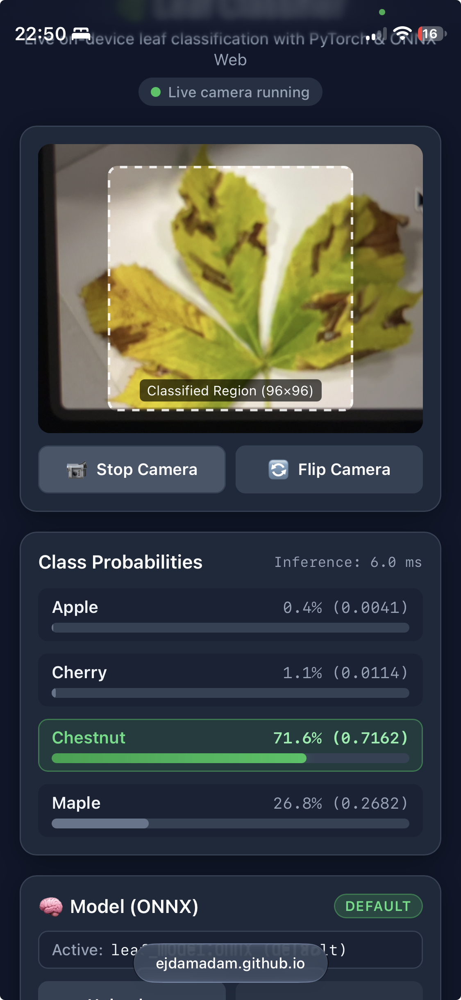
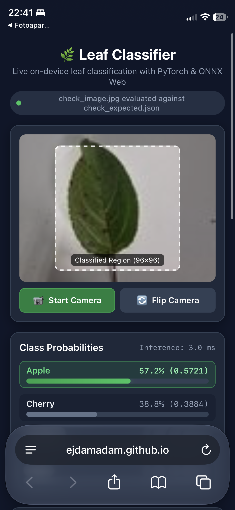
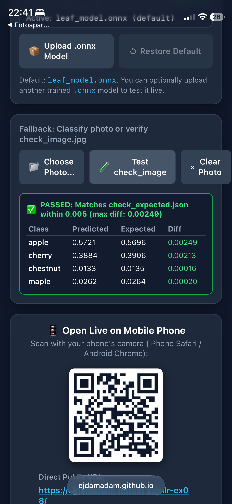

# Task 2 Review

Page URL: https://ejdamadam.github.io/mlr-ex08/

## 1. Running on phone
I opened the GitHub Pages link on my iPhone in Safari. Camera started after clicking allow permission and it classify leaves in real time.

## 2. Same numbers as notebook (`check_image.jpg`)
I tested `check_image.jpg` in the web app and compared probabilites with `check_expected.json`. That is also shown on screenshots above.

For first exported MobileNet model from Task 2:
- **apple:** page `0.2922` vs expected `0.29219`
- **cherry:** page `0.0003` vs expected `0.00027`
- **chestnut:** page `0.7075` vs expected `0.70754`
- **maple:** page `0.0000` vs expected `0.000002`

For new custom model from Task 4 (currently deployed):
- **apple:** page `0.5696` vs expected `0.56958`
- **cherry:** page `0.3906` vs expected `0.39056`
- **chestnut:** page `0.0135` vs expected `0.01349`
- **maple:** page `0.0264` vs expected `0.02637`

## 3. Preprocessing in `index.html`
In `index.html` inside function `preprocess(source)` (around lines 818-865):
- **Crop and resize:** it takes `cropSize = Math.min(srcWidth, srcHeight)` and `startX = (srcWidth - cropSize) / 2`, `startY = (srcHeight - cropSize) / 2`. Then `offscreenCtx.drawImage(source, startX, startY, cropSize, cropSize, 0, 0, 96, 96)` crops center square and resizes it to 96x96.
- **Scale and normalize:** inside loop over `96 * 96` pixels, RGB values from `imageData.data` are divided by `255.0` and standardized with `mean = [0.485, 0.456, 0.406]` and `std = [0.229, 0.224, 0.225]`.
- **Channel order:** channels are saved into `Float32Array` as planar NCHW `[1, 3, 96, 96]` - first all Red pixels (`float32Data[i]`), then Green (`float32Data[numPixels + i]`), then Blue (`float32Data[2 * numPixels + i]`). This is exact same as `ToTensor()` and `Normalize()` in PyTorch notebook.

## 4. Privacy / Nothing leaves phone
Image is never send anywhere. All calculations run locally in browser using WebAssembly (`onnxruntime-web`).
Page loads only:
- `https://cdn.jsdelivr.net/npm/onnxruntime-web@1.20.1/dist/ort.min.js` (and its `.wasm` file from same CDN) to run ONNX model in browser.
- Local files from my repo: `leaf_model.onnx`, `model_info.json`, `qrcode.min.js`, and `check_image.jpg`.
QR code is generated locally in browser by `qrcode.min.js`, so no external QR server is called.
